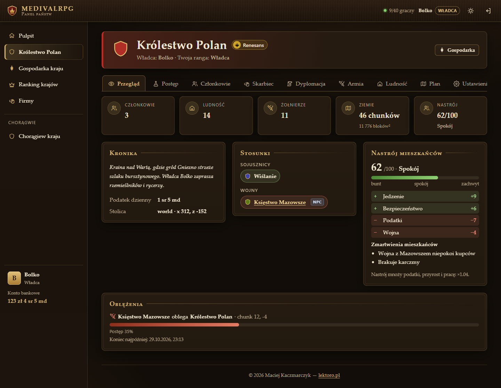
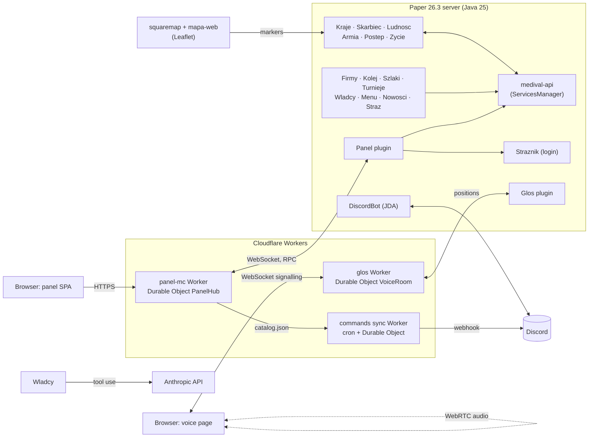
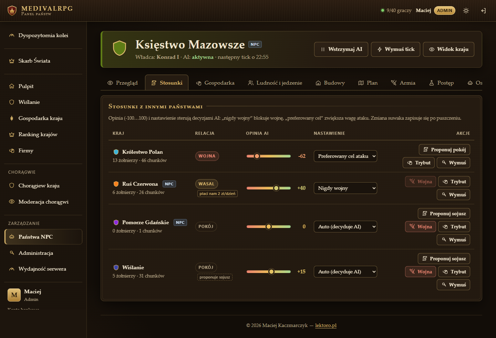
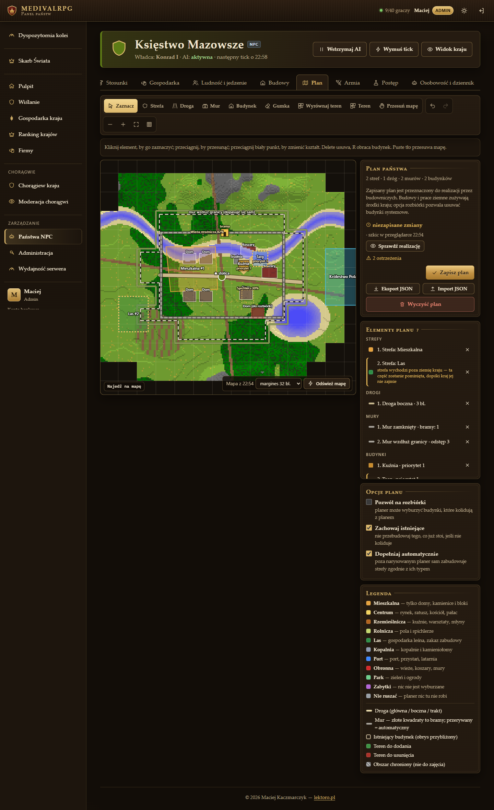
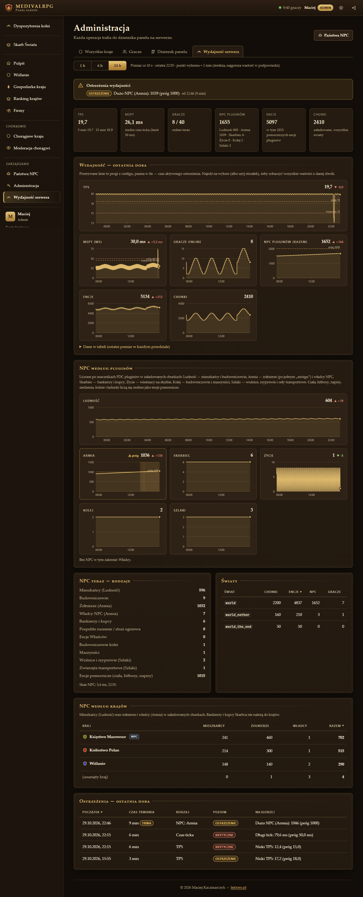
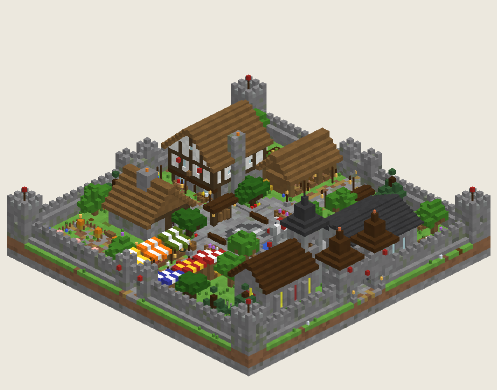

# MEDIVALRPG

A medieval nation-building Minecraft server built from scratch as about 20 cooperating Paper plugins, with a browser control panel, a live world map, a Discord bot and Cloudflare Workers backends.

Live server: [serdusie.pl](https://serdusie.pl) · Author: [Maciej Kaczmarczyk](https://mkaczmarczyk.com)



## What it is

MEDIVALRPG is a persistent multiplayer world where players found countries, claim land, run an economy and go to war, while AI-run NPC countries do the same next to them. Villagers become citizens who need housing and food and pay taxes; NPC builders construct towns block by block; NPC armies garrison borders, besiege chunks and sail across the sea. Everything is visible and partly manageable from a web panel and a map that run on Cloudflare.

The project is written in Java 25 against the Paper 26.3 API. Players use an unmodified Minecraft client: all custom visuals come from a server resource pack, BetterModel models and per-player packet changes.

Some numbers for the code in this repository:

- 24 modules, about 1,770 source files (Java, JavaScript, Python, Gradle)
- about 207,000 lines of Java production code and 49,000 lines of Java tests
- about 2,800 JUnit test methods, plus Node test suites for the Workers and headless-browser end-to-end tests for the panel

Player-facing text is Polish (MiniMessage in YAML configs). Code, identifiers and comments are English. Module folder names are Polish; the table below explains them.

## Modules

| Folder | Plugin / app | What it does |
|---|---|---|
| `medival-api` | shared API | Frozen interfaces shared between plugins (countries, treasury, population, army, progress, life), published through Bukkit `ServicesManager`. |
| `kraje` | Kraje (Countries) | Countries, chunk claims, ranks, taxes, alliances, personal unions, embassies, wars and timed sieges with boss bars and map markers. |
| `skarbiec` | Skarbiec (Treasury) | Economy: bank accounts, physical coins verified by PDC, NPC bankers and merchants, chest shops, safe player trade, closed money supply with a ledger. |
| `ludnosc` | Ludnosc (Population) | Villagers as citizens: housing, granaries, growth, taxes, construction from templates by NPC builders, town planner, mines and quarries that fill real chests. |
| `armia` | Armia (Army) | NPC soldiers, commander orders, sieges, walkable ships and naval landings, and the AI that runs NPC countries (expansion, diplomacy, war). |
| `wladcy` | Wladcy (Rulers) | Players talk to NPC rulers in natural language through the Anthropic Claude API; every action the model proposes is a tool call that the game re-validates. Quests and reputation. |
| `zycie` | Zycie (Life) | Daily routines, speech bubbles and mood of citizens; fires, bells, evacuation and paid rebuilding. Mood feeds back into taxes and growth. |
| `postep` | Postep (Progress) | Eras and a research tree per country (medieval, renaissance, with later eras prepared but switched off). |
| `firmy` | Firmy (Companies) | Player-owned guilds, trading companies and manufactories with shared accounts; money only moves between existing accounts. |
| `kolej` | Kolej (Railway) | Steam railway: animated locomotives, physical track and station build projects, timetables, driver licences, freight warehouses. |
| `szlaki` | Szlaki (Trade routes) | Merchant caravans and sea convoys along approved routes. |
| `turnieje` | Turnieje (Tournaments) | Weekly knight tournaments: brackets, mounted and melee fights, ranking and prizes. |
| `menu` | Menu | Main GUI menu, guide compass, tutorial book, spawn and player homes. |
| `nowosci` | Nowosci (News) | In-game changelog shown after login, with an optional Discord webhook. |
| `straz` | Straz (Watch) | Read-only monitoring: daily report, TPS and error alerts, nightly backup of plugin data, Discord webhook. |
| `logowanie` | Straznik (Login) | Authentication for an offline-mode server that replaced nLogin without resetting any password (see below). |
| `interakcje` | Interakcje (Interactions) | Role-play interactions, poses, dances and emotes as BetterModel player animations; resource pack hosting and verification. |
| `pory` | Pory (Seasons) | Visual seasons: per-player biome IDs rewritten in chunk packets plus a generated datapack; client-only snow and falling leaves. |
| `glos/plugin`, `glos/worker` | Glos (Voice) | Proximity voice chat: the plugin streams relative positions to a Cloudflare Durable Object; audio flows peer-to-peer over WebRTC in the browser. |
| `panel/plugin`, `panel/web` | Panel | Country management web app: Paper plugin (authoritative RPC over WebSocket) plus a Cloudflare Worker and Durable Object serving a framework-free SPA. |
| `mapa-web` | Map add-on | Leaflet add-on for the squaremap web map: country sidebar with search, sorting, details and fly-to-capital. |
| `discordbot` | DiscordBot | JDA bot: game and Discord chat bridge, roles, channel layout, war chronicle, server info and rules channels. |
| `commands-discord` | Commands sync | Cloudflare Worker with a cron trigger that keeps a Discord channel in sync with the command catalog through a webhook. |
| `spawn` | Spawn generator | Python generator for the spawn town as a WorldEdit schematic, reproducible byte for byte, with an isometric preview renderer. |

## Architecture



- **Plugins talk through interfaces only.** Each provider compiles its slice of `medival-api` into its own jar and registers it with `ServicesManager`; consumers compile against the API jar and treat soft dependencies as optional at runtime. No plugin packages another plugin's classes.
- **The game is the source of truth.** The web panel never stores game state. The Worker authenticates the browser session and forwards RPC calls over a single WebSocket to the Panel plugin, which recomputes permissions from live country ranks on every call.
- **Money is a closed system.** All amounts are `long` copper coins. After the economy migration the world has a fixed supply; payouts, NPC budgets and company loans are transfers between existing accounts, recorded in a ledger and checked by tests.
- **Persistence** is JSON or SQLite, written off the main thread with temp file, atomic replace and `.bak` copy. Bukkit API calls stay on the main thread.

## Technical highlights

**NPC armies without client mods.** Paper's `Mannequin` entity renders a player-like body but has no AI. Soldiers therefore have two entities: an invisible "brain" mob that uses the Pathfinder and Goal APIs and owns health and hitboxes, and a `Mannequin` body with a skin and country-coloured equipment that follows the brain every tick. Hits on the body are forwarded to the brain; knights use a horse as the brain. The module also covers formation orders, siege contribution, morale and desertion, per-tick time budgets, global and per-country caps, orphan cleanup on chunk load, and ships with a walkable deck and a separate helm.

**AI-run countries.** NPC countries tick on a schedule with personality parameters (aggression, expansion, diplomacy, wealth). They claim adjacent wilderness, order buildings through the population API, recruit up to a target, answer alliance and peace proposals, declare wars when they have an advantage, and plan naval landings when there is no land border. Villages found in the world can be taken over automatically and turned into NPC countries that grow from their existing layout.

**Population, construction and economy simulation.** Citizens need beds and food; growth, taxes and departures depend on housing, granary stock and mood. Buildings come from YAML templates or schematics and are placed gradually by builder NPCs, with a town planner that grades blocks of land, lays streets after levelling and backs off failing building types. Mines and quarries are finite and put their output into real chests; a full storage pauses the work.

**Password migration to Argon2id.** The server moved from the closed-source nLogin plugin to its own login plugin without resetting any password. The nLogin hash format was established from its bytecode and production config (PHC string, Argon2id, m=32768, t=5, p=1). Straznik contains a pure-Java Argon2 port of RFC 9106, tested against the RFC test vectors and 120 random cases compared byte for byte with Bouncy Castle. Imported accounts are rehashed with stronger parameters on their first successful login, and the hashes stay in PHC format so a rollback to nLogin would still verify them. The plugin also filters passwords out of the console log, rate-limits attempts and ends web panel sessions on password change.

**Web panel on Cloudflare Workers.** A Worker plus a hibernating Durable Object hold browser sessions (only SHA-256 of tokens is stored), one-time login links issued in game, persistent login rate limits per IP and per nickname, and per-session RPC limits. The plugin connects with a bearer secret compared in constant time. The SPA is plain JavaScript with no framework or CDN and includes a town plan editor, NPC country management, economy statistics, a railway dispatcher and server performance charts.

**Map and voice in the browser.** The map add-on extends squaremap's Leaflet page with a country list, search and smooth fly-to. Voice chat uses a Durable Object for WebSocket signalling and position updates, while audio goes peer-to-peer over WebRTC and is spatialised in the browser with Web Audio (low-pass filter, gain and an HRTF panner driven by in-game positions).

**Client-side seasons.** The Pory plugin rewrites biome IDs in outgoing chunk packets per player according to the season clock, using seasonal biome variants from a generated datapack. The world on disk is never changed.

**LLM-driven NPC rulers.** Wladcy uses the official Anthropic Java SDK. Rulers speak in character and remember earlier conversations, but alliances, tribute, gifts or war declarations happen only through tool calls that the plugin validates against current game state.

## Tech stack

- **Server:** Java 25, Paper API 26.3, Brigadier commands, Adventure / MiniMessage, Gson, SQLite (JDBC)
- **Build:** Gradle (Kotlin DSL) with toolchains, one Gradle build per plugin
- **Integrations:** BetterModel (models and animations), squaremap, WorldEdit, WorldGuard, JDA 5 (Discord), Anthropic Java SDK
- **Web:** Cloudflare Workers, Durable Objects (SQLite storage, Hibernation API), Wrangler, vanilla JavaScript, Leaflet
- **Tooling:** Python (model, datapack and schematic generators, Blender preview renders), Node.js test runners, Puppeteer
- **Testing:** JUnit 6, Node `node:test`, headless Chrome end-to-end tests, isolated Paper test servers

## Building and running

Requirements: JDK 25 (Gradle toolchains can download it), Node.js 20+ for the web parts.

1. Build the shared API first:

   ```bash
   cd medival-api && ./gradlew jar
   ```

2. Build any plugin, for example:

   ```bash
   cd kraje && ./gradlew build        # Windows: .\gradlew.bat build
   ```

   The jar is written to `build/libs/`. Plugins that integrate with BetterModel (`armia`, `interakcje`, `kolej`, `kraje`, `skarbiec`) compile against the BetterModel plugin jar, which is not on Maven Central: pass `-PbetterModelJar=/path/to/bettermodel.jar` or place it under `downloads/bettermodel/`. `nowosci` and `panel/plugin` compile against the nLogin jar, and `pory` against a local Paper server jar; these third-party jars are not included in the repository.

3. Web panel (local):

   ```bash
   cd panel/web
   npm install
   cp .dev.vars.example .dev.vars    # set PANEL_SECRET, same value as plugin-secret in the Panel plugin config
   npx wrangler dev
   ```

   The voice worker in `glos/worker` works the same way with `PLUGIN_SECRET`.

Secrets (Discord bot token, webhook URLs, panel and voice shared secrets, Anthropic API key) are empty in the bundled `config.yml` files and are set on the server or with `wrangler secret put`.

## Testing

- **Unit tests:** every plugin runs its JUnit suite with `./gradlew test`. Game rules are kept in plain classes (for example siege, conquest, tax, wage and planner logic) so they can be tested without a running server.
- **Workers and web:** `npm test` in `panel/web` runs unit, integration and end-to-end suites; `glos/worker` has `npm run test:int` and `npm run test:e2e`; `commands-discord` uses `node --test tests/`; `mapa-web` has a Puppeteer suite that needs a squaremap instance to serve tiles. The panel suite starts `wrangler dev` with a fake plugin and drives the SPA in headless Chrome at desktop and phone sizes; the screenshots below come from those runs with generated test data.
- **On a real server:** before each release the plugin jars were started together on an isolated Paper test server with a copy of the configuration, and scripted scenarios checked behaviour in the actual game (logins against real nLogin hashes, builders, trains, sieges, panel RPC). The orchestration scripts for those runs are tied to the private deployment and are not part of this repository.

## Screenshots

Web panel, NPC country diplomacy (AI opinion and stance per country):



Town plan editor (zones, roads, walls along the border, buildings, terrain levelling):



Server performance view (TPS, MSPT, NPC counts per plugin, warnings):



Spawn town generated by `spawn/` (isometric preview render):



## Repository notes

- Module READMEs and `docs/` (system design and the panel protocol) are written in Polish.
- Production data, worlds, player accounts, deployment packages and server-specific configuration are not included. Player names in test fixtures are fictional.

## License

All rights reserved, shared as a portfolio project.
